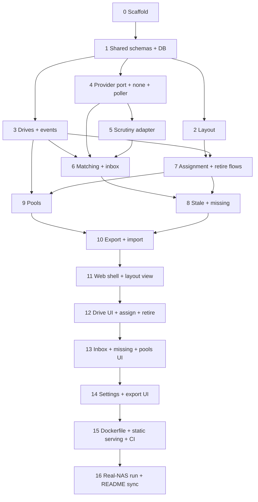

# IMPLEMENTATION_PLAN.md

Ordered build plan for Sparrow's MVP. Read `AGENTS.md` first. Take the first unchecked step, finish it, tick it, stop.

Each step lists: **Goal**, **Requirements** it covers, **Work**, and **Done when**. Steps are sized for one session.

Backend steps 2 to 10 expose their behavior through API routes as they go, so the UI steps only consume existing endpoints.

---

## Phase A: Foundations

- [x] **Step 0: Scaffold**
  - Goal: empty but green monorepo.
  - Requirements: R16.
  - Work: root `package.json` (with `packageManager` pinned to a current pnpm version) and `pnpm-workspace.yaml`, with the scripts from `AGENTS.md` section 5; commit `pnpm-lock.yaml`; `tsconfig.base.json` (strict); ESLint (including the `no-restricted-imports` rule that blocks `core` from importing `providers/*`), Prettier, Vitest in each package; `.gitignore`, `.editorconfig`, `.dockerignore`; one trivial passing test per package.
  - Done when: `pnpm install --frozen-lockfile && pnpm lint && pnpm typecheck && pnpm test` passes. Update the CI test job to pnpm first if it is not already (see `build.yml`), keeping `--if-present` until all scripts exist.

- [x] **Step 1: Shared schemas and database**
  - Goal: the data model exists, migrated and typed.
  - Requirements: R11, R13, R14, R29, R30, R39, D3, D5, D6, D7.
  - Work: zod schemas in `packages/shared` for enclosure, grid, slot (stable ID, label), drive (fields from R11, status spare/installed/retired, retirement reason/date/replacedBy/note), pool, membership (role, start, end, source), event (type, timestamp, drive, payload), and the normalized observation (Appendix A). Drizzle schema and first migration. DB opened with WAL and foreign keys on. Unique serial index on normalized serial (D6). One-drive-per-slot and one-slot-per-drive constraints (D7). Migrations run at startup.
  - Done when: repository tests cover creating each record type, the uniqueness and slot constraints, and migrating a fresh DB file. `GET /api/health` returns 200 with a small JSON body (R67).

## Phase B: Core domain (no provider involved)

- [x] **Step 2: Layout management**
  - Goal: create and edit enclosures and grids.
  - Requirements: R4, R5, R7, R38, R39, R40.
  - Work: service plus routes for enclosures, grids (rows, columns, orientation), slot labels. Seed the initial layout from R5 on first run only. Stable slot IDs; shrinking or removing an occupied slot is rejected with a clear error.
  - Done when: tests cover rename without orphaning assignments (R39), blocked shrink (R40), orientation change, and seeding that does not re-run.

- [x] **Step 3: Drives, lifecycle and event log**
  - Goal: manual spares and a complete per-drive history.
  - Requirements: R3, R11, R13, R14, R21, R26, D5, D6.
  - Work: drive service (create, edit, list with filters by status), serial normalization (trim, case-insensitive), event writer used inside the same transaction as every change, per-drive event query. Spares can be created with no provider data.
  - Done when: tests cover duplicate-serial rejection after normalization, spare creation, edits logged as events, and the absence of any hard delete.

- [x] **Step 4: Provider port, none adapter, poller**
  - Goal: the core can consume observations from any provider.
  - Requirements: R1, R18, R19, R32, R48 to R52, R54, R55, R56, R57.
  - Work: `DriveDataProvider` interface (`id`, `capabilities`, `expectedUpdateIntervalHours`, `fetchSnapshot()`, `checkConnection()`), `none` adapter, provider registry chosen by `PROVIDER` at startup, poller on `POLL_INTERVAL_MINUTES`, snapshot cache table tagged with provider ID and discarded when the provider changes, "last updated" and "provider reachable" status endpoint. On failure the last good snapshot is kept and marked stale. Write `contract.ts`: a reusable test suite that any adapter must pass (returns normalized observations, serial normalization contract, never throws on an empty list, reports connectivity failure as a result and not a crash).
  - Done when: `none` passes the contract suite; poller tests use a fake provider and cover success, failure keeping the last snapshot, and provider switch clearing the cache.

- [x] **Step 5: Scrutiny adapter**
  - Goal: real data flows in through the port.
  - Requirements: R45, R46, R53, R57, R59, Appendix B.
  - Work: copy the real capture to `test/fixtures/scrutiny-summary.json` (sanitize anything you would not publish). Adapter reads `/api/summary` unpaginated with optional bearer token, maps to the normalized observation: archived becomes `decommissioned`; type from rotational speed (0 means SSD) and protocol; health per Appendix B; empty form factor tolerated; missing SMART data becomes `unknown`; `lastReportedAt` from the collector date; `detailUrl` back to Scrutiny. Adapter config comes from `SCRUTINY_URL` and `SCRUTINY_TOKEN`, parsed inside the adapter (R45).
  - Done when: passes the contract suite; fixture tests assert, with hand-written expectations, the archived entries, the empty `nvme0` record, the NVMe with lowercase-serial "WWN", the stale NVMe, and the status/risk disagreements. **Verify the `device_status` bit meanings (1 = SMART failed, 2 = Scrutiny threshold failed) against the Scrutiny source or docs and note the result here.** No Scrutiny field names leak outside `providers/scrutiny/` (check by grep in CI-style test).

## Phase C: Flows

- [x] **Step 6: Matching and the discovery inbox**
  - Goal: observations meet records.
  - Requirements: R2, R9, R22, R23, R24, R25, R26, R58, R63.
  - Work: matching service (normalized serial, WWN fallback only). Inbox query: active observations with a serial and no matching record. Suggestion when the serial matches an existing spare, applied only on confirmation. Resolve by linking (fill missing fields from the observation) or by creating a record; either sets the status to installed and writes an event. Observations without a serial are returned as "unidentified" and are not linkable. "Import retired drives" query and action: decommissioned observations with a serial and no record; reason chosen per drive (bulk apply allowed, no silent default); retirement date prefilled from `lastReportedAt`; last known health returned as a hint only.
  - Done when: tests cover first-run inbox, spare suggestion without auto-apply, unidentified handling, retired import with and without bulk reason, and that a decommissioned observation matching an existing record is not offered.

- [x] **Step 7: Slot assignment and retirement**
  - Goal: drives move between spare, installed and retired correctly.
  - Requirements: R8, R35, R37, R60, R61, R62, D7.
  - Work: assign (drive, slot, pool, role); pool and role default to the previous occupant's (R35); assigning to an occupied slot is rejected until the occupant is resolved (back to spares, retire, RMA). Retire requires a reason and date, optional replaced-by and note, frees the slot, and logs; the occupant-resolution path offers "Retire (replaced)" with replaced-by prefilled. Reinstate retired drive as spare (history kept). Retired drives cannot be assigned.
  - Done when: tests cover every transition above, the event written for each, and the invariants from D7.

- [x] **Step 8: Stale and missing detection**
  - Goal: show problems without changing data.
  - Requirements: R10, R27, R28, R47, R56.
  - Work: staleness computed from `lastReportedAt` against the threshold (`STALE_AFTER_HOURS`, default 1.5 x the provider interval). A slot is flagged when its drive's observation is decommissioned or stale while other drives are fresh. If all tracked drives are stale, return a single provider-stale flag instead of per-slot flags. Missing-drive outcomes: back to spares, retired (reason), sent for RMA (retired as failed plus an RMA event).
  - Done when: tests cover each rule, the all-stale banner case, no automatic status change, and each outcome with its event.

- [x] **Step 9: Pools**
  - Goal: manual pool membership with history.
  - Requirements: R29, R30, R33, R35, R36, R31.
  - Work: pool CRUD (name, layout label), membership create/end/change role with dates and source (manual only in the MVP), events for join, leave and role change, membership edit from the drive detail. If the provider reports pools, expose them only as suggestions; the `none` and Scrutiny adapters may report none.
  - Done when: tests cover assignment-time membership, later edits, history preserved when a drive leaves, and event entries.

- [x] **Step 10: Export and import**
  - Goal: safe backup and restore.
  - Requirements: R41, R42, R43, R44.
  - Work: export to one JSON file with a schema version, excluding the snapshot cache, validated by the shared zod schema. Import validates first, writes an automatic export of the current data into `$DATA_DIR/exports/`, then replaces all data in one transaction. Reject unknown or newer schema versions with a clear error.
  - Done when: round-trip test (export, wipe, import, deep-equal), failed import leaves data untouched, automatic backup file created.

## Phase D: Web UI

- [x] **Step 11: Web shell and bay grid view**
  - Requirements: R4, R7, R15, D8, R18.
  - Work: Vite app with Mantine, React Router, TanStack Query client, API hooks typed by the shared schemas. App shell with navigation (Layout, Drives, Inbox, Settings), "last updated" and provider status indicator, stale banner (R47). One `BayGrid` component driven by rows, columns and orientation; slots show label, health color plus icon, empty style; click opens a detail panel.
  - Done when: component tests cover grid dimensions and orientation, empty and flagged slots; works at phone width.

- [x] **Step 12: Drives, assignment and retirement UI**
  - Requirements: R8, R11, R13, R14, R35, R36, R37, R60, R61, R62.
  - Work: drive list with status filter, create/edit form, detail panel with event log, assign-to-slot form (slot, pool, role with defaults), occupied-slot resolution dialog, retire dialog (reason, date, replaced-by showing both capacities, note), reinstate action.
  - Done when: flow tests cover assign, resolve occupant, retire with replaced-by, reinstate.

- [x] **Step 13: Inbox, missing-drive and pools UI**
  - Requirements: R9, R22, R25, R27, R29, R58, R63.
  - Work: inbox page (suggestion shown, confirm to link, or create new), "unidentified" list, import-retired-drives screen with bulk reason, missing-slot flow with the three outcomes, pool management and membership editing.
  - Done when: flow tests cover link-to-spare, create-from-observation, retired import, and each missing outcome.

- [x] **Step 14: Settings, export and import UI**
  - Requirements: R38, R41, R43, R44.
  - Work: layout editor (enclosures, grids, labels, orientation, blocked-shrink messages), export button, import with confirmation naming what will be replaced and where the automatic backup goes, read-only view of effective config (provider, interval, stale threshold) without secrets.
  - Done when: import confirmation is required, errors from the API are shown readably.

## Phase E: Delivery

- [x] **Step 15: Dockerfile, static serving and CI**
  - Requirements: R16, R17, R65, R66, R67, D10, D11.
  - Work: server serves the built web bundle and falls back to `index.html` for client routes without shadowing `/api`. Multi-stage `Dockerfile`: build stage with all workspaces, runtime stage with production dependencies only, non-root user, `PORT`, `/data` volume, health endpoint. Enable corepack (or install the pinned pnpm) in the build stage, use `pnpm install --frozen-lockfile` and `pnpm deploy --prod` (or equivalent) for the runtime stage. Make sure pnpm allows the `better-sqlite3` build script (`onlyBuiltDependencies` in `pnpm-workspace.yaml`), and verify the native module on both amd64 and arm64. In `build.yml`, remove the `--if-present` flags now that all scripts exist.
  - Done when: `docker build` works locally, `docker compose up` with the README example becomes healthy, CI is green on a pull request (image built, not pushed), and a merge to `main` publishes `latest` and `sha-<short>`.

- [ ] **Step 16: Real-NAS run and README sync**
  - Requirements: R5, R24, R64.
  - Work: deploy on the TrueNAS box with `PROVIDER=scrutiny`. Walk through first run: seed layout, resolve the inbox, import retired drives, set pools and roles. Fix what turns up. Make the README accurate (remove the pre-release note when ready, replace `OWNER`), and note the first-run findings. Record anything deferred in the parking lot.
  - Done when: the real layout (front bays, two internal SSD slots, NVMe boot) shows live health, and export/import round-trips on real data.

## Post-MVP

- [x] **Post-MVP 1: Backdatable installation date**
  - Requirements: R68 (new, at the owner's request), R14, R29, R35, R8.
  - Why: the owner may record a drive late, or register drives that were in the NAS long before Sparrow ran (first-run inbox).
  - What changed: nullable `drives.installed_on` (YYYY-MM-DD, migration 0003, CHECKs: set only while installed and required while installed). `assignDrive`, `POST /api/slots/:id/assign` and the inbox link/create endpoints take optional `installedOn` (default today UTC; rejected when later than UTC tomorrow; no cross-check against the purchase date). `PATCH /api/drives/:id` accepts `installedOn` for installed drives only (409 for spares and retired). Leaving the slot clears it. AssignDialog (and so the Inbox and first run) has an "Installed on" date field; the drive detail shows the date with an Edit dialog; the life story orders by effective date.
  - Decisions: the event `at` stays "when it was recorded"; the date lives in the payload (`drive-installed.installedOn`, `pool-joined.startedAt`, `drive-removed.installedOn`, `drive-updated.changes.installedOn` plus `membershipStartedAt`). The pool membership starts at midnight UTC of the date (or "now" when the date is today). Old export files (schema 1) without `installedOn` still import, with the same backfill as the migration (EXPORT_SCHEMA_VERSION unchanged).
  - Done when: server, shared and web tests cover assign (past, default, future), edit, spares/retired rejection, clearing on remove/retire, inbox pass-through, migration backfill, export round trip and old export, UI flows and life story order.

- [x] **Post-MVP 2: Optional installation date**
  - Requirements: R68 (made optional at the owner's request), R14.
  - Why: owner feedback, "should be optional. Having to fill it in could lead to the user just filling something if they don't know, leading to not being able to trust the information in Sparrow."
  - What changed: an installed drive may have `installed_on` NULL ("not recorded"); the `drives_installed_needs_installed_on` CHECK is gone. Defaults differ by flow, on purpose: `POST /api/slots/:id/assign` with `installedOn` omitted = today, explicit null = not recorded; inbox link/create (drives already in the NAS) omitted or null = not recorded. PATCH takes a date or null on installed drives. `drive-installed.installedOn` is null when not recorded (the membership then starts at the recording time and `startedAt` is omitted from the payload); an edit moves the membership start only when both old and new dates are known. Export files may state `installedOn: null`; old files without the key import as not recorded. UI: "Installed on (optional)" with Today and Clear (empty by default in the inbox flow, today elsewhere), "Installed: not recorded" with Set date on the detail, a Clear date button, and a life story that counts no in-service time from a recording date and says "Installation date not recorded".
  - Done when: server, shared and web tests cover the flow defaults, set/change/clear, membership rules, export round trip with null, old files, and the UI states.

- [x] **Post-MVP 3: Visual slot picker, replace-with and optional removal date**
  - Requirements: R70, R69, R8, R27, R35, R37, R60, R62, R68.
  - Why: owner feedback, "the user has to select a slot from a dropdown. The whole idea of the app is to visualise the slots to prevent errors", plus a "Replace" flow and an optional removal date.
  - What changed (web; the backend part is a separate change): `SlotPicker` (radio-group of the shared `BayGrid`, keyboard and 44px targets) replaces the slot select in `AssignDialog` (spares shelf, empty slot, inbox placement); spare `cards` replace the drive select; `ReplaceDialog` (pick a suggested spare, one optional swap date, outcome for the old drive, confirm, one assign call); `RemoveToSparesDialog` and the occupant step take an optional removal date; the life story orders and labels `drive-removed` by `removedOn`; spares-shelf rows open the drive drawer with its History and link to retired drives (`/drives?status=retired`).
  - Done when: web tests cover the picker (grids, click, keyboard, occupied tile), preselected slot, spare cards, each Replace outcome, remove dates, the missing-drive default and the story ordering.

- [x] **Post-MVP 4: Optional retirement date**
  - Requirements: R60 (retirement date made optional at the owner's request), R63, R69, R14.
  - Why: same principle as R68 and R69: an unknown date is stored as not recorded rather than guessed. The reason stays required.
  - What changed: `drives.retirement_date` may be NULL for a retired drive (the baseline CHECK `drives_retired_needs_reason_and_date` became `drives_retired_needs_reason`, edited in place, no migration). Retire, RMA and the occupant outcome take `date?: YYYY-MM-DD | null` (omitted = today UTC, null = not recorded, future rejected); import-retired takes the same (omitted = the observation's last-reported day, null = not recorded). Events carry null (`drive-retired.date`, `drive-sent-for-rma.date`, `drive-removed.removedOn`); `drive-reinstated.previousDate` may be null. Web: one optional date field (Today/Clear, helper text) in the retire dialog, the occupied-slot step, the missing-drive RMA and Replace (which now simply uses the swap date and no longer asks for a second one); the import panel date is clearable; the drive detail says "retirement date not recorded"; the life story orders by the retirement date and marks an unrecorded one with a dashed marker.
  - Done when: server tests cover retire/RMA/occupant/import with omitted, null, past and future dates, reinstate, export/import with null and a fresh-DB check of the new constraint; shared and web tests cover the schemas, the dialogs, the import panel and the life story.

- [x] **Post-MVP 6: Move**
  - Requirements: R73 (new, at the owner's request: "Can't replace and remove to spares be combined into a single move button?"), R14, R29, R35, R37, R60, R62, R68, R69, R70.
  - Why: Replace and Remove to spares were two buttons for the same physical act, taking an installed drive out of its bay.
  - What changed: `moveDrive` (`core/move.ts`) and `POST /api/drives/:id/move` (shared `move-api.ts`): destination spares | slot (+ optional occupant resolution) | retire | rma, optional `replacement` spare (pool/role default from the vacated bay, R35), one `date` (omitted = today, null = not recorded, future = 400) used as every step's date. One transaction. Web: `MoveDialog` on `StepFlow` replaces `ReplaceDialog` and the Remove to spares button; the Retire button on an installed drive opens Move with Retire chosen; `SlotPicker` can disable a slot ("Current"); the life story reads a bay-to-bay move as one entry.
  - Done when: server tests cover each destination with and without a replacement, bay-to-bay membership and events, occupant resolutions, dates, replacement rules and atomicity; web tests cover each step, the single POST and the date semantics.

---

## Parking lot (not in the MVP)

Copy from `REQUIREMENTS.md` section 6 and add new ideas here. Do not build these without a plan step.

- R12 compatibility check (compare against the vdev's usable per-disk size).
- R20 health changes in the event log.
- R34 pool leaf-count sanity check.
- Richer slot display (model, capacity, serial, temperature, pool badge).
- Reject a retirement or removal date earlier than the installation date (only the removal to spares is checked today, R69).
- Swap two installed drives (Move into an occupied bay currently sends the occupant to the spares, retirement or RMA, not into the vacated bay).
- Several providers at once.
- Automatic pool membership.
- Scheduled exports.
- Dependabot for Actions and npm packages (pnpm is supported).
- Investigate why the boot NVMe is stale in Scrutiny (collector likely lacks `--cap-add SYS_ADMIN` or the NVMe device mapping). This is a Scrutiny setup issue, not a Sparrow bug.

## Notes log

- 2026-10-11, Post-MVP 6 (R73, Move): no new event types and no schema change. A bay-to-bay move writes `drive-removed` (`movedToSlotId`, `removedOn`, `installedOn` of the old bay) and `drive-installed` (`movedFromSlotId`, `installedOn` = the move date) and leaves the open membership untouched (no pool-left/pool-joined). The moving drive's installation date restarts at the move date (null if not recorded); a move date before its installation date is rejected. Occupant resolution dates default to the move date unless the request gives one. Whenever a replacement is given and the moving drive is retired or sent for RMA, `replacedByDriveId` is the replacement (RMA included, via an optional parameter on the internal RMA helper). `assignment.ts` only gained exports (`resolveOccupant`, `resolvePoolRole`, `placeSpare`, `occupiedError` and the existing internals); `assignDrive`, `/remove`, `/retire` and `/rma` behave as before and `MissingDrivePanel` still uses them. The web dialog adds a "Which bay?" step (the slot picker is always its own step, R70) that the design list folds into step 1. Retire for a spare still uses `RetireDialog`.
- 2026-10-11, Post-MVP 5 (R70, web): Assign is now a step flow (slot picker alone, drive, occupant when the bay is occupied or after a 409, details, confirm) on a shared `StepFlow` shell that Replace also uses; fullscreen with a sticky footer on phones. Payloads are unchanged; after a 409 the occupant step is followed by details and confirm again before the call is repeated.
- 2026-10-11, Post-MVP 4 (R60, R63, optional retirement date): at the owner's request (pre-release, "not in full production") there is NO migration: the baseline `drizzle/0000_*.sql`, its snapshot and `schema.ts` were edited in place (CHECK `drives_retired_needs_reason` replaces `drives_retired_needs_reason_and_date`), so databases created by earlier builds must be wiped again (`app.db`, `app.db-wal`, `app.db-shm`); the README upgrade bullet says so. `db:generate` reports no schema changes. Retire and RMA are checked for the future but, as before, not against the installation date (parking lot). Pool membership still ends at recording time on retire. A retirement with a known date writes `drive-removed.removedOn` equal to it, otherwise null.
- 2026-10-11, Post-MVP 3 (R69, R70, web): the web declares `OccupantInput`, `RemoveInput` and a local assign body schema in `api/driveMutations.ts` so it builds before shared gains `removedOn`; once shared has it they can be replaced by the shared types. Replace suggests spares of the same type and at least the outgoing capacity (smaller ones get a non-blocking note); this is a light version of the R12 parking-lot idea and does not check the vdev's usable size. One swap date feeds the new drive's `installedOn` and the old drive's `removedOn` (spares) or retire/RMA date (required, so it is asked separately when the swap date is empty). The life story does not count in-service time before, nor shelf time after, a removal with no date.
Short, dated notes from each session (surprises, decisions, deviations). Newest first.

- 2026-10-11, Post-MVP 1 (R68, backdatable installation date): migration 0003 rebuilds `drives` to add `installed_on` plus two CHECKs. drizzle-kit's generated rebuild (`PRAGMA foreign_keys=OFF`, `__new_drives`, DROP, RENAME) does not work here: drizzle runs migrations in a transaction where that pragma is a no-op, so DROP TABLE left events and memberships violating their FKs and COMMIT failed. The shipped SQL copies the rows into a plain `__drives_copy` (backfilling `installed_on` there), drops and recreates `drives`, refills it and drops the copy, under `PRAGMA defer_foreign_keys=ON` (no RENAME, because the old CHECKs are table-qualified and break after a rename). Backfill: installed drives get the date of their latest `drive-installed` event, else of `updated_at`; tested on a DB at migration 0002 with FKs on (`test/migration-installed-on.test.ts`). Export schema stays version 1: `driveSchema` now requires `installedOn`, and `importData` upgrades files whose drives lack the key with the same rule (a file that states `installedOn: null` for an installed drive is rejected as invalid). The event log keeps `at` = when recorded; the story orders by effective date (installed: `installedOn` unless it is the same UTC day as `at`; pool-joined: `startedAt`; ties keep log order but installing precedes joining a pool), so a backdated install shows before "Added to Sparrow", with a "recorded <date>" hint, and "in service" counts from the installation date (an edit event moves the start; "Added to Sparrow" starts the shelf phase only when nothing earlier is known). The web sends the browser's local today by default and refuses empty or future dates before posting. Editing a spare or retired drive's date is 409 (state-dependent), a malformed or future date is 400. Direct repository inserts of installed rows default `installedOn` to today (test helper convenience).
- 2026-10-11: migrations squashed into a single baseline at the owner's request (pre-release, no data to preserve); existing databases created by earlier builds are NOT upgradeable — delete the data dir (app.db, app.db-wal, app.db-shm) before starting this version. The owner approved this schema/migration reset (AGENTS.md normally asks first); the baseline is `drizzle/0000_*.sql` generated from `schema.ts`, and the 0003 backfill test and its rebuild notes no longer apply.
- 2026-10-11, Post-MVP 2 (R68, optional installation date): an unknown date is stored as NULL ("not recorded") rather than guessed. The API defaults are deliberately asymmetric and documented in `assignment-api.ts`: assign omitted = today, explicit null = not recorded; inbox link/create omitted = not recorded (the drive is already in the NAS, its real date is unknown). The web sends explicit null when the field is cleared outside the inbox and omits it inside. Old export files without `installedOn` now import as not recorded (an event date is when it was recorded, not an installation date), replacing the derivation described in the Post-MVP 1 entry; files that carry the key are taken as is. The life story excludes an unrecorded phase from "in service" and shows "Installation date not recorded" instead.
- 2026-10-10, Step 15: `shared` and `server` now compile with tsc to `dist/` (`tsconfig.build.json`, tests excluded; `providers/contract.ts` moved to `test/providers/contract.ts` because it imports vitest). `@sparrow/shared` exports `source` (src), `types` (dist .d.ts) and `default` (dist js); tsconfigs set `customConditions: ["source"]` and vite/vitest set `resolve.conditions`, so typecheck, tests and Vite need no build, while plain `node` uses dist. Migrations resolve as `dist/db/../../drizzle`, the same relative layout as src, so no change was needed. Static serving uses `@fastify/static` (new dependency: maintained Fastify plugin; the stdlib route would need hand-rolled range, ETag and MIME handling) plus a not-found fallback to index.html for GET/HEAD paths outside /api that do not look like files (a missing `/assets/x.js` stays a JSON 404). `WEB_DIST_DIR` (default `packages/web/dist` relative to the server package; the image sets `/app/web`); missing bundle logs a warning and the API still works. `pnpm dev` is `scripts/dev.mjs` (initial build, `tsc -w` for both, `node --watch` on the server dist, Vite), data in `./data`. Dockerfile installs the pnpm version read from `packageManager` via npm (no corepack dependency), then `pnpm deploy --prod` (works in pnpm 12 without extra flags; `files` in the server and shared package.json keep src and tests out of the image). better-sqlite3 13 ships prebuilds (including linux-arm64 and linux-x64), so no compiler is needed and `allowBuilds` is only a safeguard. Verified here: full gate from a clean checkout without dist; docker build (amd64, with the sandbox proxy CA and a mirror.gcr.io base added to a local copy of the Dockerfile only), container healthy, `/` and `/drives` serve the UI, `/api/nope` is a JSON 404, runs as uid 1000, data survives removing and recreating the container on a named volume. Not verified: linux/arm64 image and native module (QEMU build only runs in CI), the CI workflow itself, `docker compose up` with the README file, publishing to GHCR. A bind-mounted `./data` must be writable by uid 1000 (README says so).
- 2026-10-10, Step 13: Inbox page (entry cards with observation facts and the suggestion banner, Link to a spare via picker or the suggestion, Create new record; both continue in AssignDialog, which gained an optional `placement` prop so slot, pool, role and occupied-slot resolution are reused), first-run intro when no drives exist, Unidentified list (informational), Import retired drives (inline, collapsed until Review; per-row reason with no default, date prefilled, health as a hint, bulk apply, disabled until every selected row has a valid reason and date, confirm dialog), MissingDrivePanel in DriveDetail for flagged slots (Back to spares / Retire / Send for RMA, each confirmed; RMA has date and note), Pools section on Settings (create, edit name and label, delete with the server's 409 message), MembershipSection in DriveDetail for installed drives (join, change pool or role, leave, history). Choices: create-from-observation sends no R11 extras (edit the drive afterwards); an occupant retired with reason replaced during create leaves replaced-by to the server default (the new drive); retired import starts with nothing selected. Removed pages/Placeholders.tsx (Inbox was its only user).
- 2026-10-10, Step 12: Drives page (table on desktop, cards on phone, status filter and serial/model search), drive form (capacity entered in GB/TB, stored as decimal bytes; edit sends only changed fields, cleared = null), shared DriveDetail (also used by the slot panel) with assign / remove / retire / reinstate / edit, AssignDialog (slot grouped by grid, spares only, pool and role prefilled from assignment-defaults, occupied slot goes to a resolution step with spare / retire (reason prefilled replaced, replaced-by prefilled with the incoming drive, both capacities shown) / RMA; a 409 with details.occupant also opens it), RetireDialog with a confirm step. Choices: tapping an empty tile opens the assign dialog directly; no UI for RMA outside the occupied-slot dialog; retired-drive replaced-by candidates are every other drive. Sidebar now pinned to the full viewport height; life story names pool and role. Tests stub document.fonts (Mantine autosize Textarea) and find Select options with hidden:true.
- 2026-10-10, backend review fixes: inbox link now re-runs real matching and rejects (conflict) unmatched or shared-WWN links; inbox services and getMatchState take the active provider id (R55); replacedBy chains cannot loop and explicit null means no replacement (R62); membership dates in the future are rejected and events stay stamped now with the supplied date in the payload; empty JSON body = {}; JSON 404 for unknown routes; corrupt snapshot reads as none, poller logs failures (main.ts enables the Fastify logger); observation-derived ZodErrors become 500s; previous occupant ordered by rowid in SQL; text length caps in shared; PATCH drive accepts wwn (null clears, shared WWN conflicts); buildApp defaults to api/no-provider.ts instead of importing providers/none. An observation with a model over 200 characters can no longer be created as a drive (500); not handled.
- 2026-10-10, Step 14: Settings page (`pages/SettingsPage.tsx`) with LayoutEditor, BackupSection and ConfigSection. Added `GET /api/config` (`server/src/api/config-info.ts`; provider id, poll interval, stale hours, data and backup dirs; no URLs or tokens) and `pollIntervalMinutes`/`dataDir` on AppDeps, wired in main.ts. Export is a plain anchor to /api/export. Import parses JSON client-side, then a confirm modal names current vs file counts and the backup dir; nothing is POSTed until confirmed. 409 blocked shrink/delete lists occupied slots (grid, label, drive serial from /api/drives). Current pool/event counts are not shown in the dialog (no cheap source); only drives, enclosures, grids.
- 2026-10-10, Step 11: Web app in `packages/web` (Vite 8, React 19, Mantine 9, TanStack Query, React Router 8; `zod` added as a direct web dependency because shared schemas are consumed as source). No `postcss-preset-mantine`: `src/styles.css` is plain CSS keyed on `data-mantine-color-scheme` (lightningcss rewrites `light-dark()` into a broken fallback, so it is not used). `BayGrid` takes rows, columns, orientation and a render prop; positions fill row-major in landscape and portrait is the transpose (`lib/grid.ts`). Tile states come from `lib/health.ts` (empty, missing from `flag`, stale from `stale`, else health). When the provider is stale (R47) one banner shows and stale chips are dropped, but tiles still show the stale hatching and last known health (R18). `useSlotStatus` uses `statusResponseSchema` from shared (`status-api.ts`, Step 8, uncommitted when this landed); provider status and pool schemas are local in `web/src/api/schemas.ts`. Pool badges come from `GET /api/pools/:id` per pool (open memberships); pool outline grouping from D is not done (badge plus legend only). Orientation flip button on each grid card calls PATCH /api/grids/:id. Life story is oldest first. Root `dev` runs only the Vite dev server (proxy /api to :3000); a server watch needs tsx, which is not in the stack table, so start the server separately. Visual check via Playwright against `vite preview` with intercepted API calls.
- 2026-10-10, Step 10: `packages/shared/src/export.ts` holds `exportFileSchema` (format `sparrow-export`, `EXPORT_SCHEMA_VERSION = 1`, the eight arrays validated by the existing record schemas, `appMeta` as key/value). `core/backup.ts`: `exportData` (stable order, events by `at` then id) and `importData`, which checks format and version first (newer version gives the message from the plan), then zod, then in-memory references (FKs and duplicate ids and meta keys), then writes the automatic backup with `wx` (abort if it fails), then replaces everything in one transaction. Self-reference: drives are inserted with `replacedByDriveId` null and a second pass sets it. No deferred-FK pragma. A SQLITE_CONSTRAINT error (for example a duplicate serial) rolls back and returns 400 `invalid`. Other errors give 500. The snapshot cache is neither exported nor touched. `app_meta` (including `layout.seeded`) is exported and replaced, so a restored DB is not re-seeded. The route returns the absolute `backupPath`. The default `backupDir` is `$DATA_DIR/exports`, and `main.ts` passes it explicitly. `GET /api/export` sets `Content-Disposition` with the export date. `POST /api/import` has a 50 MB body limit. Tests: 21 new (core 16, routes 5). Gate: lint and typecheck green; prettier only flags `packages/web` files of the Step 11 agent; server 276 tests.
- 2026-10-10, Step 8: `core/health-status.ts` (`computeSlotStatus`) is a pure read, so flags are never stored. `GET /api/status` (`api/status.ts`, shared `status-api.ts`) returns the slots. Decisions: "fresh" means not older than the threshold in any state (a fresh decommissioned observation still proves the provider is alive); a stale drive is flagged only while another tracked drive is fresh; an installed drive with no observation is flagged `not-reported` only while some observation is fresh (otherwise no flag, since nothing shows it vanished); `providerStale` also fires when `lastSuccessAt` itself is older than the threshold. The default threshold is `defaultStaleAfterHours(provider)` = 1.5 x interval, applied in `buildApp` when `staleAfterHours` is not passed; `STALE_AFTER_HOURS` is optional in config. Surprise: retiring an installed drive logs `drive-removed` before `drive-retired` (the slot is freed first), so an RMA logs removed, retired, sent-for-rma. Tests: 23 new (health rules and outcomes 17, route and config 6). Gate green (255 server tests).
- 2026-10-10, Step 6: `core/matching.ts` (`matchObservations`, `getMatchState`, `observationKeyOf`) is computed on every read; the key is the normalized serial, WWN (trimmed, case-insensitive) is used only when no serial matches and a WWN shared by two records matches neither. Interpretation of R9/R25: the inbox holds active observations with a serial that match no record OR match only a **spare** (a shelf spare cannot be reporting from inside the NAS, so the observation means "this spare was installed"); the spare is the `suggestion`, never applied by GET. Installed/retired matches are not in the inbox. `matched` lists every match (including spares), `matchedByDriveId` indexes it, `decommissionedMatched` is the R10 case for Step 8. Duplicate serials in a snapshot collapse to one (active first, then newest). Per the owner, link/create also pick the slot and install through `assignDrive` inside one transaction (nested drizzle transactions are savepoints; tested with an occupied slot: no drive, no fill, no event). Added nullable `drives.wwn` (migration 0002; shared `driveSchema.wwn`), set only from an observation and not editable via create/update inputs; `createDrive` takes an internal third argument for it. Link requires a spare and that the observation still matches it afterwards (same serial, or the observation's WWN), else 400/409. `import-retired` requires a reason per item (no default), date defaults to `lastReportedAt` day, all-or-nothing. REQUIREMENTS.md R23 got the approved decision sentence.
- 2026-10-10, Step 9: Membership helpers (`openMembership`, `endOpenMembership`, `startMembership`) moved from `core/assignment.ts` to `core/memberships.ts`, so assignment and the new join/change/leave share one code path; Step 7 tests unchanged and green, and the `pool-joined` payload gained `membershipId`. Joining needs an installed drive (spare or retired is 409). Changing a drive with no open membership is 409 (join first). A pool change with no role keeps the current role. Role change keeps `startedAt` and writes `pool-role-changed` `{poolId, from, to, membershipId}`. Leave clamps `endedAt` to `startedAt` and is `DELETE /api/drives/:id/membership`, which ends the row and does not delete it. Pool delete is 204 or 409 once any membership exists. Names are trimmed and unique (409 on clash). Provider pool suggestions: both adapters declare `pools = false`, so nothing is exposed (no code). Test count: 39 new (pools 31, routes 8). Typecheck is currently red only in Step 6's `core/inbox.ts` (in-progress work of the parallel agent), not in these files.
- 2026-10-10, Step 7: `core/assignment.ts` runs every action in one transaction (`assignDrive`, `removeToSpares`, `retireDrive`, `sendForRma`, `reinstateDrive`, `getAssignmentDefaults`). Pool/role defaults come from the current occupant's open membership, else the latest `drive-installed`/`drive-removed` event for that slot (a pool that no longer exists is ignored); explicit `poolId: null` means no pool and ignores `role`. Event order (oldest first): occupant `pool-left`, `drive-removed`, `drive-retired`, `drive-sent-for-rma`; incoming `pool-joined`, `drive-installed`. Slot label in events is the slot's label or `Slot <position+1>`. `drive-reinstated` payload has `previousReason/Date/ReplacedByDriveId/Note` plus `note`. Retire-as-replaced prefills replacedBy with the incoming drive only in the assign flow; the retire route leaves it empty unless given. Remove on a non-installed drive and reinstate on a non-retired drive are 409.
- 2026-10-10, Step 2: Slot position is the only identity that resizing touches (grow adds positions, shrink removes positions at or above the new count, orientation is render-only), so labels follow positions. Grid rows and columns are capped at 100 and enclosure names are not unique, as a smallest-choice default. Conflict 409s carry `details.occupied` and name slots by label or 1-based number. Layout edits write no drive events (R14 is per drive). Seeding runs in `start()` after migrations via `seedInitialLayout`, and sets `layout.seeded` even when enclosures already exist.
- 2026-10-10, Step 5: `device_status` bits verified against Scrutiny source (webapp/backend/pkg/constants.go, https://github.com/AnalogJ/scrutiny/blob/master/webapp/backend/pkg/constants.go): `DeviceStatusPassed = 0`, `DeviceStatusFailedSmart = 1`, `DeviceStatusFailedScrutiny = 2`, documented as a bitwise flag, so 3 means both. Decisions: an NVMe whose "WWN" equals its serial (case-insensitive) gets no `wwn`; entries without a `smart` block are `unknown` unless a failure bit or risk category says otherwise; `lastReportedAt` is `collector_date`, else the record's `UpdatedAt`, else the epoch (reads as stale); `driveType` is NVMe if protocol or device type says nvme; `detailUrl` is `<SCRUTINY_URL>/web/device/<device_id>` (route assumed from Scrutiny's UI, not verified); `expectedUpdateIntervalHours` is 24 from the collector's default daily cron (stale threshold 36 h); request timeout 15 s; `pools` capability false. The leak test bans snake_case Scrutiny keys found in the fixture, not `wwn` or `form_factor` (legitimate names elsewhere).
- 2026-10-10, Step 4: Port interface lives in `src/core/provider-port.ts` (re-exported by `src/providers/port.ts`) so core never imports providers; `buildApp({ db, provider? })` defaults to the none adapter; a failed poll writes a row with kept observations/lastSuccessAt, and a first-ever failure stores an empty snapshot with the error; `reachable` is false until a poll has succeeded last; overlapping polls share one in-flight run.
- 2026-10-10, Step 3: `createDrive`/`updateDrive` run `recordEvent` in the same transaction, so a failing event write rolls back the edit (tested with a trigger). Serial conflicts are checked explicitly and return 409 naming the holder. No-op edits write no event. Empty strings are stored as given; the UI should send `null`. Input schemas reuse `driveSchema.shape`, and `updateDrive` requires `@sparrow/shared` to export `drive-api.ts`.
- 2026-10-10, Step 1: zod 4 and drizzle-orm 0.45. Slot assignment is `drives.slot_id` with a unique index, which enforces both halves of D7, plus CHECKs tying it to status. Slots have a stable `position`; orientation only changes rendering. `@sparrow/shared` is consumed as TS source via package `exports`, so a build output is needed before the runtime image (Step 15). There is no runnable `pnpm dev` or start for the server yet, because running TS with `.js` specifiers needs a build or a loader. `pnpm-workspace.yaml` uses pnpm 12's `allowBuilds` (not `onlyBuiltDependencies`), so Step 15 should not re-add the old key. The Step 2 to 4 foundation tables were added in migration 0001.
- 2026-10-10, Step 0: pnpm 12.11.2 pinned. TypeScript is held at 5.9 because typescript-eslint 8.71 does not support TypeScript 7 yet; revisit when it does. Scaffolded and verified on Node 22 (`engines` is `>=22.12`); CI and the image use Node 24. The `core` import boundary rule was verified to fire. Prettier reformatted `build.yml` quotes only.
