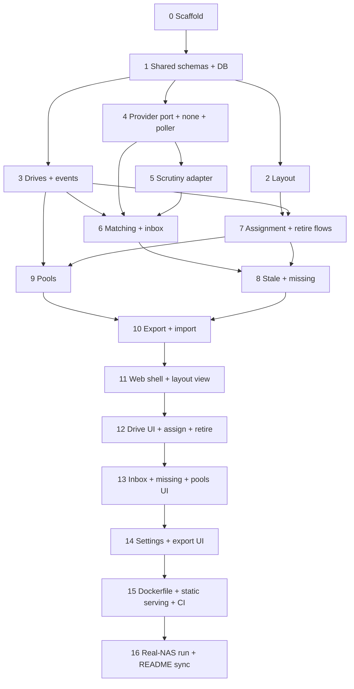

# IMPLEMENTATION_PLAN.md

Ordered build plan for Sparrow's MVP. Read `AGENTS.md` first. Take the first unchecked step, finish it, tick it, stop.

Each step lists: **Goal**, **Requirements** it covers, **Work**, and **Done when**. Steps are sized for one session.

Backend steps 2 to 10 expose their behavior through API routes as they go, so the UI steps only consume existing endpoints.

---

## Phase A: Foundations

- [x] **Step 0: Scaffold**
  - Goal: empty but green monorepo.
  - Requirements: R16.
  - Work: root `package.json` (with `packageManager` pinned to a current pnpm version) and `pnpm-workspace.yaml`, with the scripts from `AGENTS.md` section 5; commit `pnpm-lock.yaml`; `tsconfig.base.json` (strict); ESLint (including the `no-restricted-imports` rule that blocks `core` from importing `providers/*`), Prettier, Vitest in each package; `.gitignore`, `.editorconfig`, `.dockerignore`; one trivial passing test per package.
  - Done when: `pnpm install --frozen-lockfile && pnpm lint && pnpm typecheck && pnpm test` passes. Update the CI test job to pnpm first if it is not already (see `build.yml`), keeping `--if-present` until all scripts exist.

- [x] **Step 1: Shared schemas and database**
  - Goal: the data model exists, migrated and typed.
  - Requirements: R11, R13, R14, R29, R30, R39, D3, D5, D6, D7.
  - Work: zod schemas in `packages/shared` for enclosure, grid, slot (stable ID, label), drive (fields from R11, status spare/installed/retired, retirement reason/date/replacedBy/note), pool, membership (role, start, end, source), event (type, timestamp, drive, payload), and the normalized observation (Appendix A). Drizzle schema and first migration. DB opened with WAL and foreign keys on. Unique serial index on normalized serial (D6). One-drive-per-slot and one-slot-per-drive constraints (D7). Migrations run at startup.
  - Done when: repository tests cover creating each record type, the uniqueness and slot constraints, and migrating a fresh DB file. `GET /api/health` returns 200 with a small JSON body (R67).

## Phase B: Core domain (no provider involved)

- [x] **Step 2: Layout management**
  - Goal: create and edit enclosures and grids.
  - Requirements: R4, R5, R7, R38, R39, R40.
  - Work: service plus routes for enclosures, grids (rows, columns, orientation), slot labels. Seed the initial layout from R5 on first run only. Stable slot IDs; shrinking or removing an occupied slot is rejected with a clear error.
  - Done when: tests cover rename without orphaning assignments (R39), blocked shrink (R40), orientation change, and seeding that does not re-run.

- [x] **Step 3: Drives, lifecycle and event log**
  - Goal: manual spares and a complete per-drive history.
  - Requirements: R3, R11, R13, R14, R21, R26, D5, D6.
  - Work: drive service (create, edit, list with filters by status), serial normalization (trim, case-insensitive), event writer used inside the same transaction as every change, per-drive event query. Spares can be created with no provider data.
  - Done when: tests cover duplicate-serial rejection after normalization, spare creation, edits logged as events, and the absence of any hard delete.

- [x] **Step 4: Provider port, none adapter, poller**
  - Goal: the core can consume observations from any provider.
  - Requirements: R1, R18, R19, R32, R48 to R52, R54, R55, R56, R57.
  - Work: `DriveDataProvider` interface (`id`, `capabilities`, `expectedUpdateIntervalHours`, `fetchSnapshot()`, `checkConnection()`), `none` adapter, provider registry chosen by `PROVIDER` at startup, poller on `POLL_INTERVAL_MINUTES`, snapshot cache table tagged with provider ID and discarded when the provider changes, "last updated" and "provider reachable" status endpoint. On failure the last good snapshot is kept and marked stale. Write `contract.ts`: a reusable test suite that any adapter must pass (returns normalized observations, serial normalization contract, never throws on an empty list, reports connectivity failure as a result and not a crash).
  - Done when: `none` passes the contract suite; poller tests use a fake provider and cover success, failure keeping the last snapshot, and provider switch clearing the cache.

- [x] **Step 5: Scrutiny adapter**
  - Goal: real data flows in through the port.
  - Requirements: R45, R46, R53, R57, R59, Appendix B.
  - Work: copy the real capture to `test/fixtures/scrutiny-summary.json` (sanitize anything you would not publish). Adapter reads `/api/summary` unpaginated with optional bearer token, maps to the normalized observation: archived becomes `decommissioned`; type from rotational speed (0 means SSD) and protocol; health per Appendix B; empty form factor tolerated; missing SMART data becomes `unknown`; `lastReportedAt` from the collector date; `detailUrl` back to Scrutiny. Adapter config comes from `SCRUTINY_URL` and `SCRUTINY_TOKEN`, parsed inside the adapter (R45).
  - Done when: passes the contract suite; fixture tests assert, with hand-written expectations, the archived entries, the empty `nvme0` record, the NVMe with lowercase-serial "WWN", the stale NVMe, and the status/risk disagreements. **Verify the `device_status` bit meanings (1 = SMART failed, 2 = Scrutiny threshold failed) against the Scrutiny source or docs and note the result here.** No Scrutiny field names leak outside `providers/scrutiny/` (check by grep in CI-style test).

## Phase C: Flows

- [x] **Step 6: Matching and the discovery inbox**
  - Goal: observations meet records.
  - Requirements: R2, R9, R22, R23, R24, R25, R26, R58, R63.
  - Work: matching service (normalized serial, WWN fallback only). Inbox query: active observations with a serial and no matching record. Suggestion when the serial matches an existing spare, applied only on confirmation. Resolve by linking (fill missing fields from the observation) or by creating a record; either sets the status to installed and writes an event. Observations without a serial are returned as "unidentified" and are not linkable. "Import retired drives" query and action: decommissioned observations with a serial and no record; reason chosen per drive (bulk apply allowed, no silent default); retirement date prefilled from `lastReportedAt`; last known health returned as a hint only.
  - Done when: tests cover first-run inbox, spare suggestion without auto-apply, unidentified handling, retired import with and without bulk reason, and that a decommissioned observation matching an existing record is not offered.

- [x] **Step 7: Slot assignment and retirement**
  - Goal: drives move between spare, installed and retired correctly.
  - Requirements: R8, R35, R37, R60, R61, R62, D7.
  - Work: assign (drive, slot, pool, role); pool and role default to the previous occupant's (R35); assigning to an occupied slot is rejected until the occupant is resolved (back to spares, retire, RMA). Retire requires a reason and date, optional replaced-by and note, frees the slot, and logs; the occupant-resolution path offers "Retire (replaced)" with replaced-by prefilled. Reinstate retired drive as spare (history kept). Retired drives cannot be assigned.
  - Done when: tests cover every transition above, the event written for each, and the invariants from D7.

- [x] **Step 8: Stale and missing detection**
  - Goal: show problems without changing data.
  - Requirements: R10, R27, R28, R47, R56.
  - Work: staleness computed from `lastReportedAt` against the threshold (`STALE_AFTER_HOURS`, default 1.5 x the provider interval). A slot is flagged when its drive's observation is decommissioned or stale while other drives are fresh. If all tracked drives are stale, return a single provider-stale flag instead of per-slot flags. Missing-drive outcomes: back to spares, retired (reason), sent for RMA (retired as failed plus an RMA event).
  - Done when: tests cover each rule, the all-stale banner case, no automatic status change, and each outcome with its event.

- [x] **Step 9: Pools**
  - Goal: manual pool membership with history.
  - Requirements: R29, R30, R33, R35, R36, R31.
  - Work: pool CRUD (name, layout label), membership create/end/change role with dates and source (manual only in the MVP), events for join, leave and role change, membership edit from the drive detail. If the provider reports pools, expose them only as suggestions; the `none` and Scrutiny adapters may report none.
  - Done when: tests cover assignment-time membership, later edits, history preserved when a drive leaves, and event entries.

- [ ] **Step 10: Export and import**
  - Goal: safe backup and restore.
  - Requirements: R41, R42, R43, R44.
  - Work: export to one JSON file with a schema version, excluding the snapshot cache, validated by the shared zod schema. Import validates first, writes an automatic export of the current data into `$DATA_DIR/exports/`, then replaces all data in one transaction. Reject unknown or newer schema versions with a clear error.
  - Done when: round-trip test (export, wipe, import, deep-equal), failed import leaves data untouched, automatic backup file created.

## Phase D: Web UI

- [ ] **Step 11: Web shell and bay grid view**
  - Requirements: R4, R7, R15, D8, R18.
  - Work: Vite app with Mantine, React Router, TanStack Query client, API hooks typed by the shared schemas. App shell with navigation (Layout, Drives, Inbox, Settings), "last updated" and provider status indicator, stale banner (R47). One `BayGrid` component driven by rows, columns and orientation; slots show label, health color plus icon, empty style; click opens a detail panel.
  - Done when: component tests cover grid dimensions and orientation, empty and flagged slots; works at phone width.

- [ ] **Step 12: Drives, assignment and retirement UI**
  - Requirements: R8, R11, R13, R14, R35, R36, R37, R60, R61, R62.
  - Work: drive list with status filter, create/edit form, detail panel with event log, assign-to-slot form (slot, pool, role with defaults), occupied-slot resolution dialog, retire dialog (reason, date, replaced-by showing both capacities, note), reinstate action.
  - Done when: flow tests cover assign, resolve occupant, retire with replaced-by, reinstate.

- [ ] **Step 13: Inbox, missing-drive and pools UI**
  - Requirements: R9, R22, R25, R27, R29, R58, R63.
  - Work: inbox page (suggestion shown, confirm to link, or create new), "unidentified" list, import-retired-drives screen with bulk reason, missing-slot flow with the three outcomes, pool management and membership editing.
  - Done when: flow tests cover link-to-spare, create-from-observation, retired import, and each missing outcome.

- [ ] **Step 14: Settings, export and import UI**
  - Requirements: R38, R41, R43, R44.
  - Work: layout editor (enclosures, grids, labels, orientation, blocked-shrink messages), export button, import with confirmation naming what will be replaced and where the automatic backup goes, read-only view of effective config (provider, interval, stale threshold) without secrets.
  - Done when: import confirmation is required, errors from the API are shown readably.

## Phase E: Delivery

- [ ] **Step 15: Dockerfile, static serving and CI**
  - Requirements: R16, R17, R65, R66, R67, D10, D11.
  - Work: server serves the built web bundle and falls back to `index.html` for client routes without shadowing `/api`. Multi-stage `Dockerfile`: build stage with all workspaces, runtime stage with production dependencies only, non-root user, `PORT`, `/data` volume, health endpoint. Enable corepack (or install the pinned pnpm) in the build stage, use `pnpm install --frozen-lockfile` and `pnpm deploy --prod` (or equivalent) for the runtime stage. Make sure pnpm allows the `better-sqlite3` build script (`onlyBuiltDependencies` in `pnpm-workspace.yaml`), and verify the native module on both amd64 and arm64. In `build.yml`, remove the `--if-present` flags now that all scripts exist.
  - Done when: `docker build` works locally, `docker compose up` with the README example becomes healthy, CI is green on a pull request (image built, not pushed), and a merge to `main` publishes `latest` and `sha-<short>`.

- [ ] **Step 16: Real-NAS run and README sync**
  - Requirements: R5, R24, R64.
  - Work: deploy on the TrueNAS box with `PROVIDER=scrutiny`. Walk through first run: seed layout, resolve the inbox, import retired drives, set pools and roles. Fix what turns up. Make the README accurate (remove the pre-release note when ready, replace `OWNER`), and note the first-run findings. Record anything deferred in the parking lot.
  - Done when: the real layout (front bays, two internal SSD slots, NVMe boot) shows live health, and export/import round-trips on real data.

---

## Parking lot (not in the MVP)

Copy from `REQUIREMENTS.md` section 6 and add new ideas here. Do not build these without a plan step.

- R12 compatibility check (compare against the vdev's usable per-disk size).
- R20 health changes in the event log.
- R34 pool leaf-count sanity check.
- Richer slot display (model, capacity, serial, temperature, pool badge).
- Several providers at once.
- Automatic pool membership.
- Scheduled exports.
- Dependabot for Actions and npm packages (pnpm is supported).
- Investigate why the boot NVMe is stale in Scrutiny (collector likely lacks `--cap-add SYS_ADMIN` or the NVMe device mapping). This is a Scrutiny setup issue, not a Sparrow bug.

## Notes log

Short, dated notes from each session (surprises, decisions, deviations). Newest first.

- 2026-10-10, Step 8: `core/health-status.ts` (`computeSlotStatus`) is a pure read, so flags are never stored. `GET /api/status` (`api/status.ts`, shared `status-api.ts`) returns the slots. Decisions: "fresh" means not older than the threshold in any state (a fresh decommissioned observation still proves the provider is alive); a stale drive is flagged only while another tracked drive is fresh; an installed drive with no observation is flagged `not-reported` only while some observation is fresh (otherwise no flag, since nothing shows it vanished); `providerStale` also fires when `lastSuccessAt` itself is older than the threshold. The default threshold is `defaultStaleAfterHours(provider)` = 1.5 x interval, applied in `buildApp` when `staleAfterHours` is not passed; `STALE_AFTER_HOURS` is optional in config. Surprise: retiring an installed drive logs `drive-removed` before `drive-retired` (the slot is freed first), so an RMA logs removed, retired, sent-for-rma. Tests: 23 new (health rules and outcomes 17, route and config 6). Gate green (255 server tests).
- 2026-10-10, Step 6: `core/matching.ts` (`matchObservations`, `getMatchState`, `observationKeyOf`) is computed on every read; the key is the normalized serial, WWN (trimmed, case-insensitive) is used only when no serial matches and a WWN shared by two records matches neither. Interpretation of R9/R25: the inbox holds active observations with a serial that match no record OR match only a **spare** (a shelf spare cannot be reporting from inside the NAS, so the observation means "this spare was installed"); the spare is the `suggestion`, never applied by GET. Installed/retired matches are not in the inbox. `matched` lists every match (including spares), `matchedByDriveId` indexes it, `decommissionedMatched` is the R10 case for Step 8. Duplicate serials in a snapshot collapse to one (active first, then newest). Per the owner, link/create also pick the slot and install through `assignDrive` inside one transaction (nested drizzle transactions are savepoints; tested with an occupied slot: no drive, no fill, no event). Added nullable `drives.wwn` (migration 0002; shared `driveSchema.wwn`), set only from an observation and not editable via create/update inputs; `createDrive` takes an internal third argument for it. Link requires a spare and that the observation still matches it afterwards (same serial, or the observation's WWN), else 400/409. `import-retired` requires a reason per item (no default), date defaults to `lastReportedAt` day, all-or-nothing. REQUIREMENTS.md R23 got the approved decision sentence.
- 2026-10-10, Step 9: Membership helpers (`openMembership`, `endOpenMembership`, `startMembership`) moved from `core/assignment.ts` to `core/memberships.ts`, so assignment and the new join/change/leave share one code path; Step 7 tests unchanged and green, and the `pool-joined` payload gained `membershipId`. Joining needs an installed drive (spare or retired is 409). Changing a drive with no open membership is 409 (join first). A pool change with no role keeps the current role. Role change keeps `startedAt` and writes `pool-role-changed` `{poolId, from, to, membershipId}`. Leave clamps `endedAt` to `startedAt` and is `DELETE /api/drives/:id/membership`, which ends the row and does not delete it. Pool delete is 204 or 409 once any membership exists. Names are trimmed and unique (409 on clash). Provider pool suggestions: both adapters declare `pools = false`, so nothing is exposed (no code). Test count: 39 new (pools 31, routes 8). Typecheck is currently red only in Step 6's `core/inbox.ts` (in-progress work of the parallel agent), not in these files.
- 2026-10-10, Step 7: `core/assignment.ts` runs every action in one transaction (`assignDrive`, `removeToSpares`, `retireDrive`, `sendForRma`, `reinstateDrive`, `getAssignmentDefaults`). Pool/role defaults come from the current occupant's open membership, else the latest `drive-installed`/`drive-removed` event for that slot (a pool that no longer exists is ignored); explicit `poolId: null` means no pool and ignores `role`. Event order (oldest first): occupant `pool-left`, `drive-removed`, `drive-retired`, `drive-sent-for-rma`; incoming `pool-joined`, `drive-installed`. Slot label in events is the slot's label or `Slot <position+1>`. `drive-reinstated` payload has `previousReason/Date/ReplacedByDriveId/Note` plus `note`. Retire-as-replaced prefills replacedBy with the incoming drive only in the assign flow; the retire route leaves it empty unless given. Remove on a non-installed drive and reinstate on a non-retired drive are 409.
- 2026-10-10, Step 2: Slot position is the only identity that resizing touches (grow adds positions, shrink removes positions at or above the new count, orientation is render-only), so labels follow positions. Grid rows and columns are capped at 100 and enclosure names are not unique, as a smallest-choice default. Conflict 409s carry `details.occupied` and name slots by label or 1-based number. Layout edits write no drive events (R14 is per drive). Seeding runs in `start()` after migrations via `seedInitialLayout`, and sets `layout.seeded` even when enclosures already exist.
- 2026-10-10, Step 5: `device_status` bits verified against Scrutiny source (webapp/backend/pkg/constants.go, https://github.com/AnalogJ/scrutiny/blob/master/webapp/backend/pkg/constants.go): `DeviceStatusPassed = 0`, `DeviceStatusFailedSmart = 1`, `DeviceStatusFailedScrutiny = 2`, documented as a bitwise flag, so 3 means both. Decisions: an NVMe whose "WWN" equals its serial (case-insensitive) gets no `wwn`; entries without a `smart` block are `unknown` unless a failure bit or risk category says otherwise; `lastReportedAt` is `collector_date`, else the record's `UpdatedAt`, else the epoch (reads as stale); `driveType` is NVMe if protocol or device type says nvme; `detailUrl` is `<SCRUTINY_URL>/web/device/<device_id>` (route assumed from Scrutiny's UI, not verified); `expectedUpdateIntervalHours` is 24 from the collector's default daily cron (stale threshold 36 h); request timeout 15 s; `pools` capability false. The leak test bans snake_case Scrutiny keys found in the fixture, not `wwn` or `form_factor` (legitimate names elsewhere).
- 2026-10-10, Step 4: Port interface lives in `src/core/provider-port.ts` (re-exported by `src/providers/port.ts`) so core never imports providers; `buildApp({ db, provider? })` defaults to the none adapter; a failed poll writes a row with kept observations/lastSuccessAt, and a first-ever failure stores an empty snapshot with the error; `reachable` is false until a poll has succeeded last; overlapping polls share one in-flight run.
- 2026-10-10, Step 3: `createDrive`/`updateDrive` run `recordEvent` in the same transaction, so a failing event write rolls back the edit (tested with a trigger). Serial conflicts are checked explicitly and return 409 naming the holder. No-op edits write no event. Empty strings are stored as given; the UI should send `null`. Input schemas reuse `driveSchema.shape`, and `updateDrive` requires `@sparrow/shared` to export `drive-api.ts`.
- 2026-10-10, Step 1: zod 4 and drizzle-orm 0.45. Slot assignment is `drives.slot_id` with a unique index, which enforces both halves of D7, plus CHECKs tying it to status. Slots have a stable `position`; orientation only changes rendering. `@sparrow/shared` is consumed as TS source via package `exports`, so a build output is needed before the runtime image (Step 15). There is no runnable `pnpm dev` or start for the server yet, because running TS with `.js` specifiers needs a build or a loader. `pnpm-workspace.yaml` uses pnpm 12's `allowBuilds` (not `onlyBuiltDependencies`), so Step 15 should not re-add the old key. The Step 2 to 4 foundation tables were added in migration 0001.
- 2026-10-10, Step 0: pnpm 12.11.2 pinned. TypeScript is held at 5.9 because typescript-eslint 8.71 does not support TypeScript 7 yet; revisit when it does. Scaffolded and verified on Node 22 (`engines` is `>=22.12`); CI and the image use Node 24. The `core` import boundary rule was verified to fire. Prettier reformatted `build.yml` quotes only.
