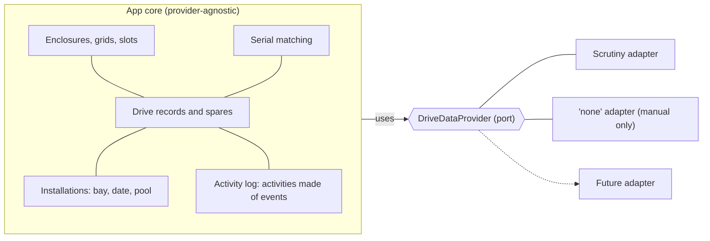

# Sparrow: Requirements

Sparrow keeps your spares in rows. Status: requirements settled (v1.2 draft). Defaults in section 7 are confirmed.

Changes since v1.0: visual slot picking, "Replace" and optional removal dates (R69, R70), slot history (R74); retirement reasons and reinstating (R13, R60 to R62), seeding retired drives from decommissioned observations (R63, moved from backlog), delivery items (R64 to R67: README with compose example, CI pipeline, Dockerfile, health endpoint), defaults confirmed (D5 revised, D10 and D11 added).

Changes since v1.1: project named Sparrow (D12), frontend stack decided (D9), pnpm as package manager (D13).

Changes since v1.2 (2026-10-13, owner request): no seeded layout; a skippable first-run setup wizard instead (R5, R77).

Changes since v1.2 (2026-10-12, owner decision): the activity model. Tables hold the situation as it currently is (a drive installed in a bay is an installation row that carries the pool and role; the drive's status is computed), and history lives only in the activity log: each user action is an activity made of atomic events that carry enough to replay and undo them (R14, R29, R33, R35, R41, R43, R68, R69, R73, R74, R75).

## 1. Purpose

A self-hosted web app, run as one Docker container on the NAS, that:

1. Shows where each drive physically sits (named grids of slots).
2. Tracks cold spares and each drive's lifecycle (spare, installed, retired).
3. Optionally enriches this with live health data from a pluggable provider (Scrutiny first).

The core must stay fully usable when the provider is unavailable or replaced.

## 2. Environment and observed facts

- NAS OS: TrueNAS. One enclosure.
- Pools: `big` (1 x raidz2 vdev, 8 HDDs), `fast` (1 x mirror vdev, 2 SSDs), `boot-pool` (NVMe).
- Physical layout: front bays are 8 HDD slots in a 4x2 grid. Two internal SSD slots (left and right, not front-accessible). One NVMe boot slot.
- Scrutiny: `starosdev/scrutiny:latest-omnibus` (fork, collector v1.76.4), SMART collector runs daily at 00:00 UTC.
- Observed in the Scrutiny API (verified against real output):
  - `serial_number` and `wwn` are present on devices. `sdX` names are reused across drives, so they are not identity.
  - The NVMe's "WWN" is its serial in lowercase. One empty `nvme0` record has no serial or WWN. The NVMe boot drive's last report was 2026-07-01 (collector likely lacks NVMe access).
  - No HDD/SSD field exists. `rotational_speed` is 0 for SSDs. `form_factor` can be empty.
  - Archived devices are included in the `/api/summary` response. There are 4 (3 HDDs, 1 SSD) that look like previously retired drives.
  - ZFS pool details identify vdev leaves only by partition UUID, with no serial or WWN.
- Pool `big` mixes 2, 3 and 4 TB drives. Usable size per disk is limited by the smallest member (relevant to R12).

## 3. Architecture

Principles:
- The core owns all records (layout, drives, installations, pools, activities and events).
- Providers only report observations. Links are computed by serial, never stored.
- No provider field name, enum or ID reaches the core, UI, DB or export (R53).

## 4. Requirements (MVP)

### 4.1 Layout
- R4: An enclosure contains one or more named grids. Each grid has configurable rows and columns, and each slot can have a label.
- R5 (changed 2026-10-13 at the owner's request): There is no built-in layout. A new install does not create an enclosure; it greets the user with the skippable setup wizard (R77), where the owner can build what used to be seeded: grid "Front bays" (8 slots, 4x2), grid "Internal SSDs" (2 slots, Left and Right) and grid "Boot" (1 slot).
- R7: Grid orientation (4 columns by 2 rows, or the reverse) is configurable.
- R38: Enclosures and grids are created and edited in the web UI (name, rows, columns, slot labels) and stored in SQLite.
- R39: Slots have stable internal IDs. Renaming a grid or relabeling a slot never orphans an assignment or its history.
- R40: Removing a slot or shrinking a grid that would drop an occupied slot is blocked until the occupant is resolved.

### 4.2 Drives and lifecycle
- R3: The app owns bay positions, cold-spare records and pool membership.
- R11: Drive fields: serial, model, capacity, type (HDD/SSD/NVMe), form factor, storage location, condition (new/used/tested) with last test date, purchase date, warranty expiry, vendor, notes.
- R13: Each drive has one record for its whole life, with a status: spare, installed or retired. Purchase and warranty info stays attached. (changed 2026-10-12 at the owner's request: the status is computed, not stored: retired if the drive has a retirement reason, else installed if it has an installation (R29), else spare.)
- R14: Every change is logged. The log is browsable per drive. (changed 2026-10-12 at the owner's request, replacing the 2026-10-11 event links: the log is made of ACTIVITIES, one per user or system action, and an activity is a group of atomic EVENTS that happened together. An event is one fact about at most one drive, one slot and one pool, and carries enough to apply it and to undo it (the whole record for something created or deleted, from and to for every changed field), so any past state can be rebuilt by replaying the log forward or undoing it backward. An activity has a kind (installed, replaced, moved, swapped, retired, pool changed, and so on), the time it was recorded, an optional note, a monotonic `seq` that all ordering uses (never the timestamps), and the user's own date for the action (`occurred_on`, empty = not recorded). That date IS the new date of what the action did: the installation date of a drive installed, the removal date of a drive uninstalled, the retirement or RMA date of a drive retired; events do not repeat it and carry only the old values needed to undo. A drive arriving in an occupied bay is therefore one `replaced` activity (the outgoing drive's `drive-uninstalled`, optionally its retirement, and the incoming drive's `drive-installed`), a move between bays one `moved` activity, a swap one `swapped` activity. Activity and events are written in the same transaction as the change, so a failed write leaves neither, and every state change writes exactly one activity; the one stated exception is importing retired drives (R63), which writes one activity per item because retirements on different days did not happen together. Slot and pool columns of an event have no foreign key and keep a copy of the bay's label and grid name and of the pool's name, so history survives a deleted grid or pool. Even the first-run seed layout is logged, so no change is unlogged. Readers group events by activity and never pair events across activities: a drive's history is every activity with an event for the drive, each with ALL its events, so the story can say who replaced whom.)
- R21: Spares are created manually and can exist without any provider data.
- R8: Slot assignment is manual, picked from drives that have a record in the app. Retired drives cannot be assigned to a slot.
- R23: Linking or creating a drive from an observation sets its status to "installed" and writes an event. Decision (2026-10-10): resolving an inbox entry also picks the slot (with pool and role), so an installed drive always has a slot (D7).
- R37: Assigning a drive to an occupied slot first requires resolving the current occupant (see R27 and R62). The app never silently replaces it.
- R60: Retiring a drive requires a reason (failed, replaced, other) and optionally takes a retirement date (default today, editable, can be cleared; an empty date means "not recorded", it cannot be in the future) (retirement date made optional 2026-10-11 at the owner's request: an unknown date is stored as not recorded rather than guessed). It optionally takes a note. (changed 2026-10-11 at the owner's request: 'replaced by' removed; slot history shows what replaced what) Retiring a drive that sits in a slot frees the slot and logs the event. (changed 2026-10-13 at the owner's request: a retirement or RMA date, like every removal date (R69), cannot be earlier than the drive's installation date when that is known; the 400 names both dates.)
- R61: A retired drive can be reinstated as a spare. The retirement reason and date stay in the event history.
- R62: Retiring is available from the drive's detail panel at any time, and as an outcome in the missing-slot flow (R27). When assigning a drive to an occupied slot, the occupant resolution offers "Retire it" (broken or done) with a reason the user must choose (no preset), a date and a note, next to back to spares and RMA. (changed 2026-10-11 at the owner's request: 'replaced by' removed; slot history shows what replaced what)
- R68 (added 2026-10-11 at the owner's request; made optional 2026-10-11 at the owner's request: an unknown date is stored as not recorded rather than guessed): An installed drive may have an installation date. Assigning a spare defaults it to today, and it can be set to a past date or cleared ("not recorded"); a drive found in the NAS and placed from the inbox starts as not recorded. The date can be set, changed or cleared later while the drive is installed; the log still records when the change was made. (changed 2026-10-12 at the owner's request: the date is `installed_on` of the installation and the date of the installing activity (R14); a later edit is an `installation-updated` event with the old and new date, in a drive-edited activity.)
- R69 (added 2026-10-11 at the owner's request): Returning a drive to spares takes an optional removal date, like R68's installation date. When the removal is done now ("Remove to spares", the occupant outcome, "Replace") it defaults to today and can be backdated or cleared; in the missing-drive flow (R27) it starts empty because the drive went missing at an unknown time. Empty means "not recorded" and is shown that way in the life story; the date cannot be in the future or before the installation date. The log still records when the change was made. (changed 2026-10-12 at the owner's request: memberships have no start date any more, so the 'before the pool membership start' rule is gone, and the removal date is the date of the uninstalling activity (R14). When a replacement uninstalls an occupant, that is one physical act on one day: the occupant's removal or retirement date IS the activity's date. Leaving it out means that date, and a request that names a different date for the occupant is refused (400). The check 'not before the installation date' compares the activity's date with the occupant's own installation date.) Retiring or sending for RMA takes its own optional date (R60). (changed 2026-10-13 at the owner's request: the 'not before the installation date' rule now holds in EVERY flow that takes a drive out of its bay or moves it: remove, retire, RMA, Move with any outcome, the occupant's resolution when assigning, linking or moving into an occupied bay, and swap; a pool join or leave date cannot precede the installation date either. A drive with no installation date recorded, or a date left empty, is not checked. Text taken from a provider observation is cut to the record's field limits when it fills or creates a record, and R72 compares the same cut values. A failed poll is logged with the provider's URL, credentials removed, and the reason.)
- R70 (added 2026-10-11 at the owner's request): Slots are always chosen on a visual bay grid (the same grid as the Layout page, honoring rows, columns and orientation), never from a list: assigning from the spares shelf, from an empty slot and from the inbox. Occupied slots are selectable and lead to the occupant step (R37). An installed drive offers "Replace", which swaps it in one step: pick the replacement from the spares (same-type drives of at least the same capacity are suggested first, smaller ones carry a note, both capacities are shown, R60), one optional swap date (the new drive's installation date and the old drive's removal date, R68, R69), then what happens to the old drive (back to spares, retire with a reason, or RMA, R27, R62). Pool and role default from the old drive (R35).
- R71 (added 2026-10-11 at the owner's request): The Inbox is reached from the Drives page, not from the main navigation. The Drives page header has an "Inbox" button next to "Add drive" that shows the inbox count (R9) as a badge, prominent when the count is above zero and quiet at zero. The inbox page lives at `/drives/inbox` (the old `/inbox` redirects), has a back link to Drives, and keeps "Drives" highlighted in the navigation. Other links to the inbox (such as the "N in Inbox" chip) point there too. (The page is labelled "Discovered" in the UI, renamed 2026-10-11 at the owner's request.)
- R72 (added 2026-10-11 at the owner's request): For a drive record that currently matches an observation (R2), the app suggests updates to the model, capacity, type, form factor and WWN. A field the record lacks and the observation has is a "fill" suggestion; a field both have with different values (compared trimmed, case-insensitively for model, form factor and WWN; exactly for capacity and type) is a "differs" suggestion. Suggestions are computed on every read from the record and the cached snapshot (R54, R55), never stored, and never applied automatically (R10): the owner ticks fields in the drive detail and confirms, which edits the drive through the normal update path in one transaction and writes one `drive-updated` event marked `source: 'provider'` (R14, R53: no provider ID or field names). A suggestion that stopped applying is refused (409). Only "fill" suggestions raise indicators (an "Updates" flag on the Drives list, a "Suggested updates" section on the inbox page); "differs" suggestions stay quietly collapsed in the drive detail. Each suggestion can be dismissed (changed 2026-10-11 at the owner's request): `POST /api/drives/:id/suggestions/dismiss` writes one `suggestion-dismissed` event per field, `{ field, value }` with the value that was suggested, in one transaction (a field that is not currently suggested is refused, 409, nothing written). A suggestion is hidden while the drive's latest such event for that field carries the same value (compared as above); if the provider later reports a different value it shows again. Dismissed suggestions do not count toward any indicator or the `GET /api/suggestions` counts, stay listed in the drive detail behind "N dismissed", and `POST .../suggestions/undismiss` restores them by writing an event with `value: null` (the latest event per field decides). Nothing provider-specific is stored (R53). (changed 2026-10-12: applying is one `suggestions-applied` activity, dismissing one `suggestions-dismissed` activity with one event per field, and restoring one `suggestions-restored` activity.)
- R73 (added 2026-10-11 at the owner's request): An installed drive has one Move action (replacing the separate "Replace" and "Remove to spares" buttons): it goes to the spares, another bay, retirement or RMA, optionally with a spare taking its place, as one step with one optional date; a move between bays keeps pool membership. The date (default today, empty = not recorded) is the removal, retirement or RMA date of this drive, its installation date in a new bay and the installation date of the incoming spare. Moving into an occupied bay asks what happens to that drive (R37). The first option is Swap (added/changed 2026-10-11 at the owner's request): the two installed drives trade bays in the same transaction, both keep their pool membership, one `swapped` activity names both drives, one date applies to both, and no spare can be given for the vacated bay (the swap fills it). It is one API call, one transaction and one activity (R14). Retire stays a separate button for spares. (changed 2026-10-12 at the owner's request, replacing the 2026-10-11 drive-moved, drives-swapped and drive-replaced events: a Move is ONE `moved` activity however many bays it touches. It holds a `drive-uninstalled` and a `drive-installed` event for the moved drive (it keeps its pool and role), the occupant's uninstall and, if retired, its retirement, and the spare's `drive-installed` in the vacated bay. A swap is one `swapped` activity of two uninstalls and two installs. Everything in the activity happens on its one date, so the occupant of the destination bay leaves on the move date too (R69).)
- R74 (added 2026-10-11 at the owner's request): Each slot has a history of every drive that occupied it, with installed and removed dates and how each left (moved to another slot, back to the spares, retired with its reason, or sent for RMA). It is computed from the log on every read, never stored, and refers to the slot by its stable ID so renaming keeps it (R39). It is shown as the "Slot" tab of the History section (next to "Drive", the drive's own history) for an installed drive and for an occupied slot, and alone for an empty slot; a spare or retired drive shows only its own history. Unrecorded dates are shown as "not recorded" (R68, R69). The drive history links entries about a slot to that slot's history. (changed 2026-10-12 at the owner's request: it is built from the `drive-installed` and `drive-uninstalled` events of the bay (and later installation-date edits, R68), through the indexed slot column, with no scanning of event payloads. How a drive left, and which drive took its place, are read from the OTHER events of the SAME activity: its retirement or RMA, the bay it was installed in again (moved, or swapped with the other drive), the drive installed in its bay (replaced by). Events of different activities are never paired. Renamed bays and deleted grids keep their history, because events copy the bay's label and grid name.)
- R20 (moved into scope 2026-10-11 at the owner's request; was in the post-MVP backlog): Health changes are written to the log (R14). After each successful poll, every drive record that matches an observation of the active provider (R2, R55) is compared with its last recorded health, which is the `to` of its latest `health-changed` event (no extra column). The first report writes `health-changed` with `from: null`; a difference writes `{ from, to, reportedAt }`, where `reportedAt` is the observation's last-reported time and the event time is the poll time. Values are the normalized health values only (R53). All events of one poll are written in one transaction; a failed poll, or a snapshot from another provider, writes nothing. Staleness and decommissioned state are not health changes (R10, R63), and the drive's status is never touched (flag only). The life story reads "Health: OK → Warning" or "Health first reported: OK" with the health icon and colour, ordered by `reportedAt`. (changed 2026-10-12 at the owner's request: one poll is one `health-polled` activity, recorded at the poll time, with a `health-changed` event per changed drive, and none if nothing changed. They are observations of the drive's state, not changes to our records: they stay in the log and the life story, but replaying or undoing the log ignores them.)
- R75 (added 2026-10-11 at the owner's request): Layout and pool changes are written to the log too (R14), in the same transaction as the change: enclosure created, renamed or deleted; grid created, updated (with each changed field's from and to) or deleted; slot relabeled; pool created, updated (changed fields) or deleted. These events belong to no drive. A change that makes no difference (same name, same label) writes nothing. (changed 2026-10-12 at the owner's request: layout changes are `layout-updated` activities and pool record changes `pool-edited` activities. The first-run seed layout (R5) is ONE `layout-updated` activity, so no change is unlogged. Created and deleted things carry their whole record, a grid with its slots, and deleting an enclosure logs each of its grids with their slots and then the enclosure, so the log can rebuild or undo them. `GET /api/activities/recent?limit=50` returns the latest activities, newest first, each with all its events (drive serials, bay labels, pool names); `GET /api/pools/:id/history` returns the activities with an event on the pool (its record changes, drives joining, leaving or changing role, and drives installed in or uninstalled from it), and each card on the Pools page has a collapsed 'History' list, sorted by the day it shows. A pool that no installation references can be deleted; its history keeps its name. Recent changes feed (added 2026-10-13 at the owner's request): the feed now exists. `GET /api/activities/recent?limit=&before=<seq>` pages with an exclusive seq cursor (both validated). The Layout page ends with a 'Recent changes' card (the latest 5, 'Show all') and `/activity` lists everything with 'Load more'; the page is reached from that link and from Settings, not from the navigation. Each activity is ONE plain-language sentence from a neutral point of view (for example 'ZL2SPR01 (8 TB) replaced ZL2ABC03 in Front bays, 3 · ZL2ABC03 retired (failed)', 'Swapped ZL1 (Front bays, 2) and ZL2 (Front bays, 1)', "Grid 'Front bays' resized 4 × 2 → 4 × 3", 'Pool tank created', 'Health: ZL1 OK → Warning'), with an icon per kind, serials linking to the drive and bays to the bay's history. The date is the activity's own day, else the day it was recorded, with 'recorded ...' when they differ. An empty log reads 'Nothing has happened yet'. A `grid-updated` event also carries the grid after the change (`after`) so the feed can name it and show both sizes.)
- R76 (added 2026-10-11 at the owner's request): Pools have their own page in the navigation: Layout, Drives, Pools, Settings. Each pool is a card with its name, layout label, size check (R34) and current members (serial, capacity, bay, role); a member opens the drive's detail. Creating, editing and deleting pools moved there from Settings.
- R77 (added 2026-10-13 at the owner's request): First-run setup wizard. While the database has no enclosure and the `setup` flag in app_meta is neither `done` nor `skipped`, the Layout page opens a skippable step-by-step wizard (the same step flow as the other dialogs; fullscreen with a sticky footer on a phone) instead of an empty layout. Steps: (1) Welcome: what Sparrow does and, when the provider reports drives, "Scrutiny found N drives"; Start, or "Skip, I'll set it up later". (2) Enclosure name (default "NAS"). (3) Grids: one or more, each with a name, columns x rows, orientation and bay labels (default 1 to n, editable in place in a live preview that is the real bay grid component), added from quick-add presets (4, 8 or 12 bays, 2 internal SSDs labelled Left and Right, 1 boot drive) or Custom, removable and reorderable; at least one. (4) Pools, optional ("Skip this step"): name, layout label (free text; raidz1, raidz2, raidz3, mirror, stripe and single are suggested) and expected drives. (5) Review of what will be created, then Create. (6) Done, pointing at Drives > Discovered when the provider found drives, otherwise at adding a drive. Create writes the enclosure, grids with slots and labels and pools in ONE transaction and ONE `layout-updated` activity (R14, R75; its events are enclosure-created, grid-created with the slots, pool-created), then sets the flag to `done`; if any part is invalid nothing is written. Skipping sets the flag to `skipped`; the Layout page then shows "No enclosure yet" with "Set up now" and a link to Settings > Layout, and Settings > Layout offers "Run setup wizard" while there is no enclosure. `GET /api/setup` returns `{ state: "needed" | "skipped" | "done" }` (an install that already has an enclosure is `done`), `POST /api/setup` takes `{ enclosureName, grids: [{ name, rows, columns, orientation, labels? }], pools: [{ name, layoutLabel?, expectedMembers? }] }` and is refused with 409 once an enclosure exists, `POST /api/setup/skip` sets `skipped`. Separately, at startup the server checks that the opened database has every table and column of the current schema and, if not (a file from an incompatible pre-release build), exits with a message to delete `app.db`, `app.db-wal` and `app.db-shm`.

### 4.3 Discovery and matching
- R2: Observations are matched to records by normalized serial, with WWN as a fallback. Never by device name (`sdX`) or provider-internal IDs.
- R26: Serials are normalized before comparison (trim whitespace, case-insensitive).
- R9: A "New drives discovered" inbox lists active (not decommissioned) observations whose serial matches no record. The UI flags when it is non-empty.
- R22: Resolving an inbox entry means linking it to an existing spare (fields the spare lacks are filled from the observation) or creating a new drive record from it.
- R25: If the observation's normalized serial matches an existing spare, the inbox suggests that spare. Nothing changes until you confirm.
- R24: On first run all observed drives appear in the inbox, so initial setup uses the same flow.
- R58: Observations without a serial (such as the empty `nvme0` record) are shown as "unidentified", informational only, and are not linkable or in the inbox.
- R63: A skippable "Import retired drives" step, offered after first-run setup and available later from the inbox page, lists decommissioned observations that have a serial and no matching record. For each, you pick a reason (failed, replaced, other). Bulk-applying a reason is allowed, but there is no silent default. The retirement date is prefilled from the observation's last-reported time (approximate, editable, and it can be cleared to record none, R60). Serial, model, capacity and type are filled from the observation. The observation's last known health is shown as a hint (for example "failed") and is never applied automatically. Decommissioned observations that match an existing record are not offered (that is the R10 case). (changed 2026-10-12: the import writes one `retired-imported` activity per item, dated with its own retirement date, all in one transaction, because retirements on different days did not happen together.)

### 4.4 Missing and stale detection
- R10: A slot is flagged when its drive's observation is decommissioned, or when its last-reported time is older than the stale threshold while other drives are fresh. Flag only, never automatic changes.
- R27: A flagged slot shows "drive missing". The record stays "installed" until you choose an outcome: back to spares, retired (with a reason, see R60), or sent for RMA (retired as failed, plus an RMA event). The outcome is logged.
- R28: The stale threshold is configurable in hours. Its default is 1.5 x the provider's declared update interval (Scrutiny: 24h, so 36h).
- R56: Each provider declares an expected update interval.
- R47: If every tracked drive is stale at once, the UI shows one "provider data is stale" banner instead of flagging each slot.

### 4.5 Pools
- R29: Pool membership is a property of a drive's installation: the pool and the pool role (data, hot spare) are columns of the row that says drive X sits in bay Y. It is always manually editable. (changed 2026-10-12 at the owner's request: there are no membership rows, start or end dates or sources any more. The installation exists only while the drive is installed, with the drive as its key and the bay unique (D7), so a drive is in at most one pool by keys, and removing the drive from its bay deletes the row and takes it out of the pool. Joining, leaving and role changes are in the activity log (R14, R33). A pool can be deleted when no installation references it; the history keeps its name.)
- R30: Pools are records in the app DB (name, layout label such as raidz2 or mirror). If the provider supports pools, its list can suggest or seed them, but it is not required.
- R31: Automatic membership detection is out of scope for the MVP (see section 2: leaves are identified by partition UUID only).
- R35: The assign-to-slot form asks for pool and role together with the slot. Pool and role default to those of the drive previously in that slot. (changed 2026-10-12: the previous occupant is the live installation being replaced, else the pool and role of the latest `drive-uninstalled` event of that bay in the log; a pool that has been deleted is not offered.)
- R36: Pool and role stay editable later from the drive's detail panel.
- R34 (changed 2026-10-11 at the owner's request: moved from the backlog into scope, and compared with an owner-entered count instead of the provider's): A pool may have an expected number of drives (set when creating or editing the pool, optional). The app compares the pool's current members with it and shows "5 of 6 drives — one missing" or "7 drives, expected 6" (icon and text) on the pool; no expected number means no check. The check is computed on every read and only flags, never changes anything (R10).
- R33: Pool membership changes (joined, left, role change) are written to the log. (changed 2026-10-12 at the owner's request: they are `pool-joined`, `pool-left` and `pool-role-changed` events, each about the drive, its bay and the pool, one activity per action (`pool-joined`, `pool-left`, `pool-role-changed`, and `pool-changed` for a switch to another pool, which holds a pool-left and a pool-joined). They are written only when the pool of an EXISTING installation changes; installing or uninstalling a drive sets or clears its pool as part of its own events and writes none. A date the user gives for a join or leave becomes the activity's date.)

### 4.6 Provider port
- R1: The core manages drives, slots, spares, pools and events on its own. Drive data comes from a pluggable provider. Scrutiny is the first.
- R48: The core defines a TypeScript interface `DriveDataProvider` with a pull-based snapshot fetch and a connectivity check. The core imports nothing from any adapter.
- R49: Normalized observation shape (see Appendix A).
- R50: A provider declares capabilities: drives (required) and pools (optional).
- R51: Exactly one provider is active at a time, chosen in config at startup. Switching means changing config and restarting.
- R52: A built-in "none" provider (no observations) must work, so the app is fully usable by hand.
- R53: Adapters own provider quirks and mapping. No provider field names or enums reach the core, UI, DB or export.
- R54: Links are computed, not stored. Observations are matched by serial on each snapshot, and no provider IDs are saved.
- R55: The snapshot cache stores normalized observations tagged with a provider ID, and is discarded when the active provider changes.
- R18: The server polls the active provider on an interval and stores a normalized snapshot in SQLite. The UI shows a "last updated" time. If the provider is unreachable, the last known state stays visible, marked stale.
- R19: Poll interval is configurable, default 5 minutes.
- R32: Drives, spares, slots, installations, pools and the activity log live in the app's own DB and stay fully usable when the provider is unreachable or removed.
- R57: A shared contract test suite that every adapter must pass. The Scrutiny adapter is tested against a real `/api/summary` capture as a fixture.

### 4.7 Scrutiny adapter
- R45: Adapter settings (base URL, optional bearer token) are namespaced environment variables owned by the adapter, not core settings.
- R46: Reads `/api/summary` unpaginated. Archived entries (included in the response) map to "decommissioned".
- R59: Mapping: drive type from rotational speed (0 means SSD) and protocol (NVMe). Missing SMART data maps to health "unknown", never "ok". An empty form factor is tolerated. Health mapping: see Appendix B.

### 4.8 Slot display (MVP)
- R15: Each slot shows the slot label, a normalized health color and an empty-slot style. Clicking opens a detail panel with the full record and event log.

### 4.9 Export and import
- R41: A button exports all app data (enclosures, grids, slots, drives, installations, pools, activities with their events) as one JSON file. (changed 2026-10-12 at the owner's request: export format version 3. Drives hold no bay or status, installations hold the bay, date and pool of each installed drive, and activities are nested with their events in `seq` order; see R14.)
- R42: The export contains a schema version and excludes the snapshot cache.
- R43: A matching import restores an export. It replaces all existing data and asks for confirmation first. (changed 2026-10-12 at the owner's request: only version 3 files import; version 1 and 2 files, from pre-release builds with an older format, are rejected with a clear message and change nothing. `seq` is preserved, the normalized serial is recomputed from the serial, installations must point at drives, bays and pools in the file and a bay or drive appears at most once, and an event's drive must be in the file while its slot and pool need not exist, because those rows may have been deleted.)
- R44: Before an import overwrites anything, the app saves an export of the current data automatically.

### 4.10 Platform
- R16: TypeScript, one container serving the API and the web UI, SQLite in a single file on a mounted volume.
- R17: Runs on a trusted LAN with no authentication.
- R66: A `Dockerfile` in the repo root builds the image: multi-stage, runs as a non-root user, listens on `PORT`, stores data in the `/data` volume.
- R67: `GET /api/health` returns 200 with a small JSON body. It does not depend on the provider, so it stays healthy when the provider is down. Used by the compose healthcheck.

### 4.11 Delivery
- R64: `README.md` in the repo root contains: overview, status, a docker compose example (published GHCR image, port, `/data` volume, provider env vars, healthcheck), a configuration table, provider notes (Scrutiny, none), backup and restore (export/import), image tags and how CI publishes them, and development notes.
- R65: A GitHub Actions workflow `.github/workflows/build.yml`:
  - Triggers: push to `main`, version tags (`v*`), pull requests, manual dispatch.
  - Job 1: install Node, run lint, typecheck and tests (each skipped if the package script does not exist yet).
  - Job 2: build a multi-arch image (linux/amd64 and linux/arm64) with Buildx. Push to GHCR only on `main` and version tags. Pull requests build without pushing.
  - Image tags: `latest` (main), `X.Y.Z` and `X.Y` (version tags), `sha-<short>`.
  - Uses the built-in `GITHUB_TOKEN` with `packages: write` on the image job only, a GitHub Actions build cache, and provenance attestations disabled to keep the GHCR platform listing clean.

## 5. Non-goals
- N1: Authentication or user management. (added 2026-10-12: still no login, but the API refuses what another web page could trigger: every non-GET `/api` request must send `content-type: application/json` (415 otherwise), responses forbid framing and content sniffing, and the optional `ALLOWED_HOSTS` restricts the Host header against DNS rebinding. This is hardening, not authentication.)
- N2 (MVP): Calling the TrueNAS API.
- N3 (MVP): Scheduled automatic exports.

## 6. Post-MVP backlog
- R12: Compatibility check "can this spare replace the drive in slot X?" (changed 2026-10-13 at the owner's request). Sparrow does not model vdevs, so a pool is treated as one vdev: its usable per-disk size is the smallest capacity among its current members (installations with that pool), including the drive being replaced (so for `big`, a 2 TB spare fits the bay of a 4 TB member while 2 TB is the smallest). A spare fits a bay when it has the same drive type as the bay's occupant (for an empty bay, its previous occupant, R35) and a capacity of at least the target size: the pool's usable size when that occupant is in a pool, else the occupant's own capacity. An unknown type or capacity on either side gives "unknown", never "doesn't fit"; an empty bay with no history has no check. The result per spare is `fits`, `too-small` (with the size needed), `different-type` or `unknown`, plus a short reason. It is advice: it never blocks an action. It is computed on every read, never stored.
- Richer slot display: model, capacity, serial, temperature, pool badge.
- Several providers at once with priority (observations are already tagged by provider).
- Automatic pool membership (resolve partition UUIDs via `/dev/disk/by-partuuid` and `by-id`, or the TrueNAS API).
- Scheduled automatic exports.
- Dependabot for GitHub Actions and npm packages.

## 7. Defaults (confirmed)
- D1: Container port default 3000 (Scrutiny uses 8080 and 8086).
- D2: Config via environment variables. SQLite at `/data/app.db` on the mounted volume.
- D3: Timestamps stored in UTC and displayed in the browser's local time.
- D4: Capacities displayed in decimal units (4 TB), matching drive labels.
- D5: Drive records are never hard-deleted in the MVP. Use the "retired" status with a reason (R60).
- D6: Serial numbers are unique across drive records. Duplicates are blocked on entry.
- D7: One drive per slot, and one slot per drive.
- D8: The UI is responsive and usable on a phone.
- D9: Frontend: React + Vite + TypeScript, served as a static bundle by the backend (one image, one port). Mantine for components, TanStack Query for data fetching, React Router for pages, and zod schemas shared between API and UI (also used for the export/import format). Project structure is decided in the implementation plan.
- D10: Image platforms: linux/amd64 and linux/arm64.
- D11: The image is published to GitHub Container Registry (`ghcr.io/<owner>/<repo>`).
- D12: Project name: Sparrow. Repository, image and container are named `sparrow` (image `ghcr.io/<owner>/sparrow`).
- D13: Package manager: pnpm (workspaces), pinned with the `packageManager` field. CI and the Dockerfile use it.

## Appendix A: Normalized observation (R49)

| Field | Type | Notes |
|---|---|---|
| serial | string | Required for linking. Observations without it are "unidentified" (R58). |
| wwn | string, optional | Fallback match only. |
| model | string, optional | |
| capacityBytes | number, optional | |
| driveType | HDD / SSD / NVMe, optional | |
| formFactor | string, optional | |
| health | ok / warning / failed / unknown | Mapped by the adapter. |
| lastReportedAt | ISO timestamp | Basis for staleness (R10, R28) and the retirement date prefill (R63). |
| state | active / decommissioned | |
| temperatureC | number, optional | |
| detailUrl | string, optional | Link back to the provider's own page. |

## Appendix B: Scrutiny health mapping (R59)

Inputs: `device_status` (bit field: 1 = SMART failed, 2 = Scrutiny threshold failed; consistent with the README's health labels, to verify in the adapter tests) and `risk_category`.

| Normalized health | Condition |
|---|---|
| failed (red) | SMART-failed bit set, or risk is `replace_soon` |
| warning (amber) | Scrutiny-failed bit set, or risk is `plan_replacement` |
| ok (green) | Otherwise (`monitor` counts as ok) |
| unknown | No SMART data |

A stale drive keeps its last known health, marked stale. Raw provider details are shown in the drive's detail panel.

## Appendix C: Configuration (suggested)

| Variable | Default | Purpose |
|---|---|---|
| `PORT` | 3000 | HTTP port |
| `DATA_DIR` | `/data` | SQLite and exports |
| `PROVIDER` | `none` | `scrutiny` or `none` |
| `POLL_INTERVAL_MINUTES` | 5 | R19 |
| `ALLOWED_HOSTS` | unset (any) | N1 hardening: comma list of accepted Host names (added 2026-10-12) |
| `STALE_AFTER_HOURS` | derived (36 for Scrutiny) | R28 |
| `SCRUTINY_URL` | none | Adapter setting (R45) |
| `SCRUTINY_TOKEN` | none | Optional, if Scrutiny auth is enabled |
